# Scitizia: 140 props low poly em glTF/GLB com visual retrô de 64 bits

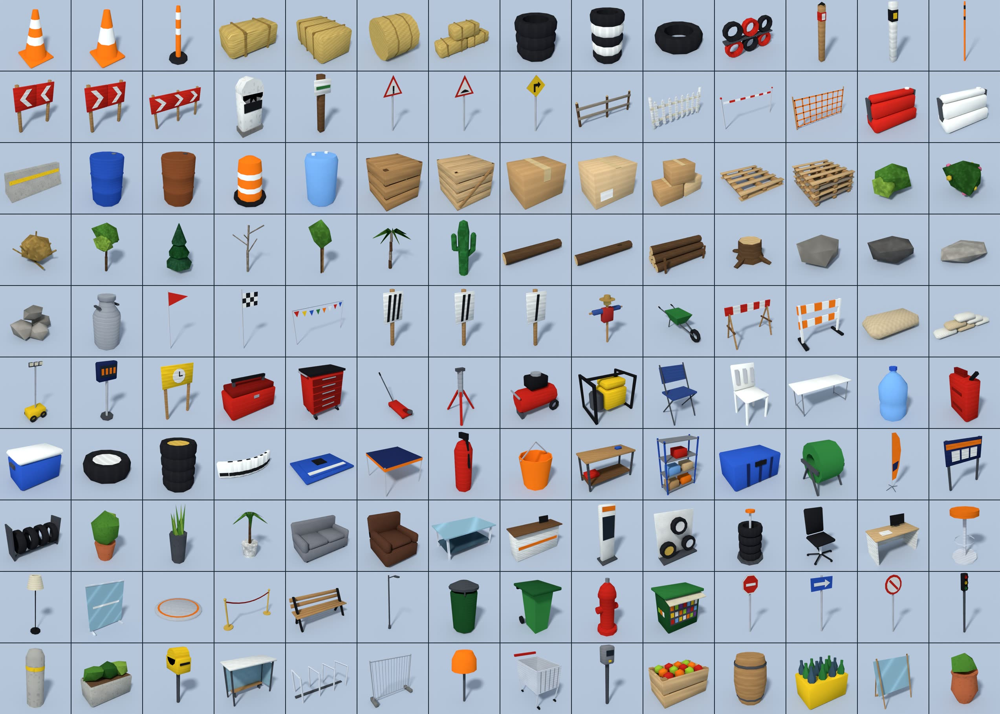

**Scitizia: props 64 bits** é uma coleção gratuita de 140 objetos de cenário em baixo polígono (low poly), com o visual retrô dos consoles de 64 bits, prontos para jogos em tempo real: beira de estrada de rali, parque de apoio da equipe, concessionária e cidade. Cada prop é um arquivo glTF 2.0 binário (`.glb`) de 6,0 a 144,7 KB, com 20 a 1.408 triângulos (218 em média), cor por vértice e uma textura pequena de 64×64 px por material, com filtro bilinear. 67 deles quebram: o mesmo arquivo traz o objeto inteiro e os pedaços pré-fraturados, e o catálogo traz massa, resistência ao impacto, colisor e os pedaços de cada um, para a física do seu jogo derrubar, arremessar e quebrar os objetos. Os props foram feitos para o jogo **Scitizia Rally Championship**; tudo é genérico, sem marca, logotipo ou texto de empresa real.

**English summary:** Scitizia 64-bit props is a free collection of 140 low-poly scenery objects with a retro 64-bit console look: rally roadside (cones, hay bales, tyre stacks, wooden marker posts, chevron signs, fences, barriers, crates, saplings, logs, rocks), service park, car dealership and town props. Every prop is a binary glTF 2.0 (`.glb`) file with 20 to 1408 triangles, vertex colors and one small 64×64 texture per material. 67 props are breakable: each file holds the whole object (`Inteiro`) and pre-fractured pieces (`Peca_00`, `Peca_01`...), and [`catalogo.json`](catalogo.json) lists mass, break impulse, a simple collider and the pieces of every prop, ready for a physics engine. Units are meters, Y is up, the front faces +Z and the origin sits on the ground. Public domain (CC0 1.0).

## Resumo

| | |
|---|---|
| Props | 140: corrida e beira de estrada 73, parque de apoio 26, concessionária 17, cidade 24 |
| Formato | glTF 2.0 binário (`.glb`), texturas também em PNG |
| Triângulos por prop | 20 a 1.408 (média 218) |
| Quebráveis | 67, com 2 a 7 pedaços pré-fraturados |
| Materiais | metal 41, madeira 28, plástico 23, vegetal 10, tecido 9, borracha 7, concreto 7, palha 4, pedra 4, vidro 4, papelão 3 |
| Texturas | uma por material, 64×64 px, em tons de cinza (a cor vem da cor por vértice) |
| Escala e eixos | metros, Y para cima, frente em +Z, origem no chão, no centro |
| Objetos | `Inteiro` (o prop montado) e, nos quebráveis, `Peca_00`, `Peca_01`... |
| Catálogo legível por máquina | [`catalogo.json`](catalogo.json) |
| Licença | domínio público, [CC0 1.0](LICENSE) |

## Corrida e beira de estrada

Cones, fardos de feno, pneus, madeiras-guia, placas de curva, balizas de quilometragem, cercas, barreiras, tambores, caixas, paletes, arvoretas, arbustos, toras e pedras: o que fica na beira de um estágio de rali e pode ser atropelado. 73 props.

| Prévia | Prop | Material | Massa | Quebra | Voa | Triângulos | Onde serve |
|---|---|---|---|---|---|---|---|
| 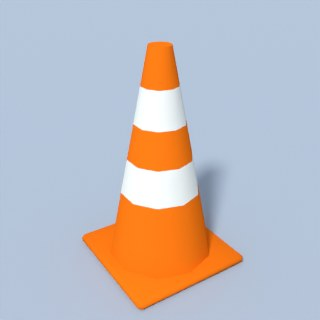 | **Cone de trânsito**<br>`cone_transito` | plástico | 3,0 kg | não | sim | 184 | corrida, parque de apoio, cidade |
| 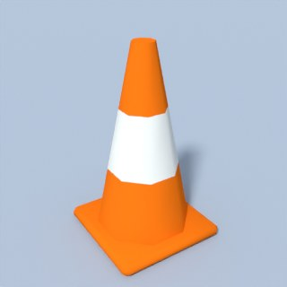 | **Cone pequeno**<br>`cone_pequeno` | plástico | 1,2 kg | não | sim | 108 | corrida, parque de apoio |
| 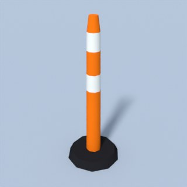 | **Delineador tubular**<br>`delineador` | plástico | 4,0 kg | não | sim | 136 | corrida, cidade |
| 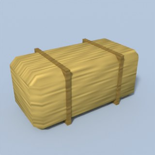 | **Fardo de feno pequeno**<br>`fardo_feno` | palha | 22 kg | sim, 3 pedaços (110 N·s) | sim | 68 | corrida, parque de apoio |
| 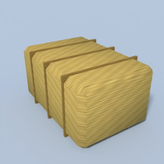 | **Fardo de feno grande**<br>`fardo_feno_grande` | palha | 380 kg | sim, 4 pedaços (1.900 N·s) | não | 80 | corrida |
| 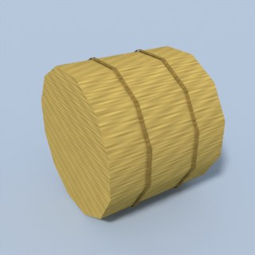 | **Rolo de feno**<br>`fardo_redondo` | palha | 300 kg | sim, 4 pedaços (1.800 N·s) | não | 96 | corrida |
| 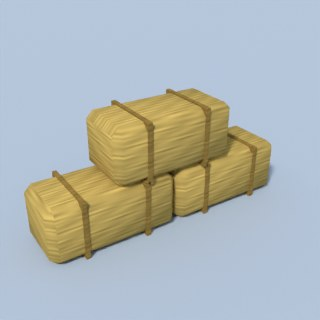 | **Pilha de fardos**<br>`fardos_pilha` | palha | 66 kg | sim, 3 pedaços (165 N·s) | não | 204 | corrida, parque de apoio |
| 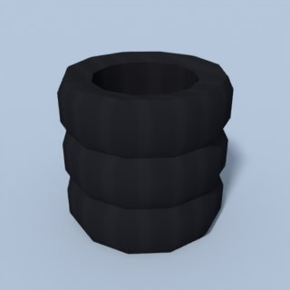 | **Pilha de 3 pneus**<br>`pneus_pilha_3` | borracha | 27 kg | sim, 3 pedaços (81 N·s) | sim | 432 | corrida, parque de apoio |
| 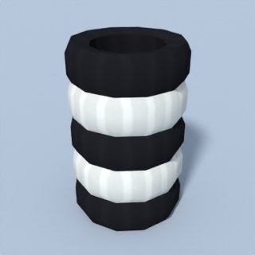 | **Pilha de 5 pneus pintados**<br>`pneus_pilha_5` | borracha | 45 kg | sim, 5 pedaços (135 N·s) | não | 720 | corrida |
| 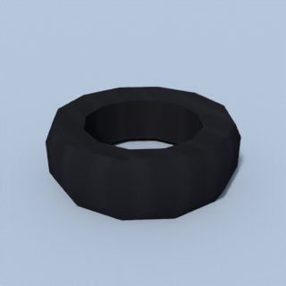 | **Pneu velho**<br>`pneu_velho` | borracha | 9,0 kg | não | sim | 144 | corrida, parque de apoio, cidade |
| 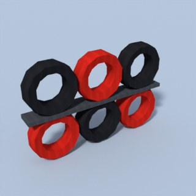 | **Barreira de pneus**<br>`barreira_pneus` | borracha | 70 kg | sim, 7 pedaços (245 N·s) | não | 876 | corrida |
| 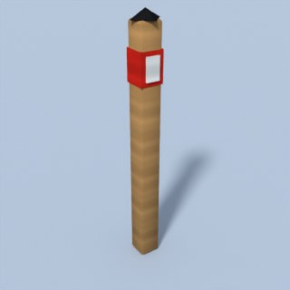 | **Madeira-guia**<br>`estaca_guia` | madeira | 6,0 kg | sim, 3 pedaços (21 N·s) | sim | 76 | corrida |
| 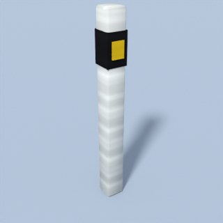 | **Madeira-guia pintada**<br>`estaca_guia_branca` | madeira | 6,0 kg | sim, 2 pedaços (21 N·s) | sim | 68 | corrida, cidade |
| 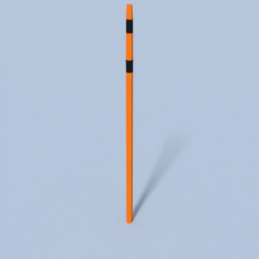 | **Estaca de neve**<br>`estaca_neve` | plástico | 2,0 kg | sim, 2 pedaços (12 N·s) | sim | 72 | corrida |
| 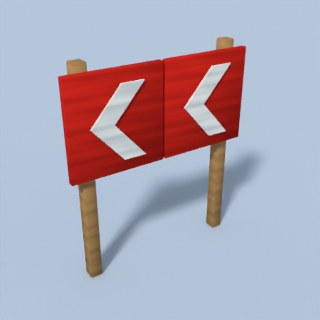 | **Placa de curva à esquerda**<br>`placa_chevron_esq` | madeira | 18 kg | sim, 4 pedaços (54 N·s) | sim | 216 | corrida |
| 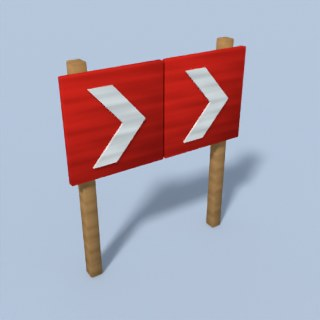 | **Placa de curva à direita**<br>`placa_chevron_dir` | madeira | 18 kg | sim, 4 pedaços (54 N·s) | sim | 216 | corrida |
|  | **Placa larga de curva**<br>`placa_chevron_tripla` | madeira | 32 kg | sim, 5 pedaços (96 N·s) | sim | 280 | corrida |
| 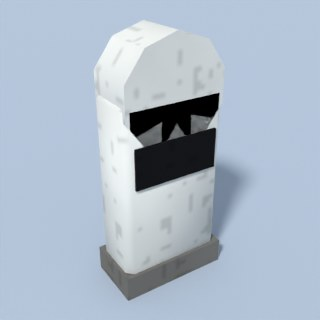 | **Marco de quilometragem**<br>`baliza_km` | concreto | 90 kg | não | não | 108 | corrida, cidade |
| 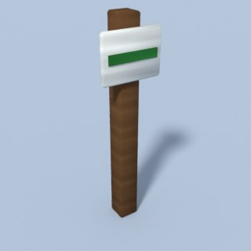 | **Marco de madeira**<br>`baliza_km_madeira` | madeira | 12 kg | sim, 2 pedaços (42 N·s) | sim | 100 | corrida |
| 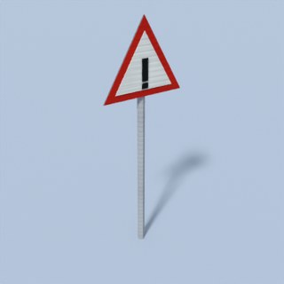 | **Placa de atenção**<br>`placa_atencao` | metal | 12 kg | sim, 2 pedaços (120 N·s) | sim | 64 | corrida, cidade |
| 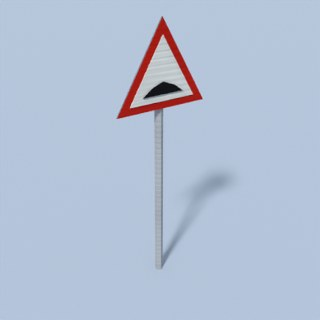 | **Placa de salto**<br>`placa_pulo` | metal | 12 kg | sim, 2 pedaços (120 N·s) | sim | 56 | corrida |
| 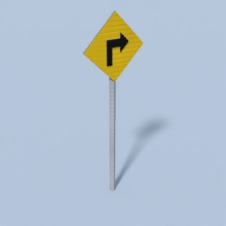 | **Placa de curva perigosa**<br>`placa_curva_perigosa` | metal | 12 kg | sim, 2 pedaços (120 N·s) | sim | 68 | corrida, cidade |
| 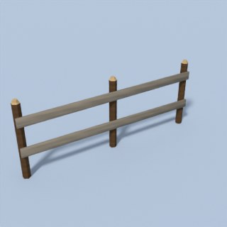 | **Cerca de madeira rústica**<br>`cerca_madeira` | madeira | 40 kg | sim, 5 pedaços (120 N·s) | sim | 232 | corrida |
| 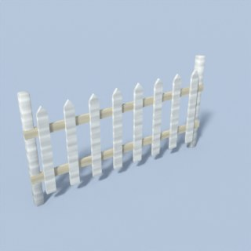 | **Cerca de ripas branca**<br>`cerca_branca` | madeira | 22 kg | sim, 7 pedaços (66 N·s) | sim | 240 | corrida, cidade |
| 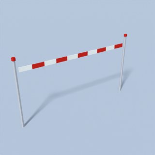 | **Cerca de fita zebrada**<br>`cerca_fita` | plástico | 2,0 kg | sim, 4 pedaços (5 N·s) | sim | 200 | corrida, parque de apoio, cidade |
| 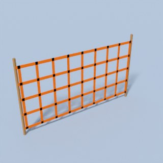 | **Cerca de tela plástica**<br>`cerca_tela` | plástico | 4,0 kg | sim, 2 pedaços (12 N·s) | sim | 208 | corrida, parque de apoio |
| 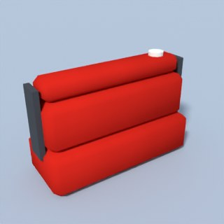 | **Barreira plástica vermelha**<br>`barreira_plastico` | plástico | 45 kg | não | não | 188 | corrida, parque de apoio, cidade |
| 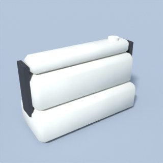 | **Barreira plástica branca**<br>`barreira_plastico_branca` | plástico | 45 kg | não | não | 188 | corrida, parque de apoio, cidade |
| 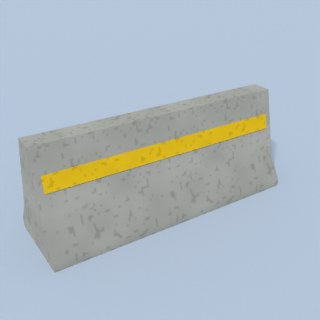 | **Barreira de concreto**<br>`barreira_concreto` | concreto | 900 kg | não | não | 40 | corrida, cidade, parque de apoio |
| 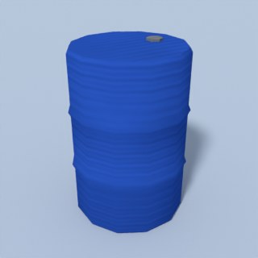 | **Tambor de metal azul**<br>`tambor_metal` | metal | 18 kg | não | sim | 264 | corrida, parque de apoio, cidade |
| 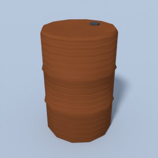 | **Tambor enferrujado**<br>`tambor_enferrujado` | metal | 18 kg | não | sim | 264 | corrida, parque de apoio |
| 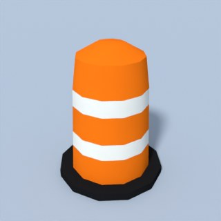 | **Tambor de sinalização**<br>`tambor_listrado` | plástico | 9,0 kg | não | sim | 216 | corrida, cidade |
| 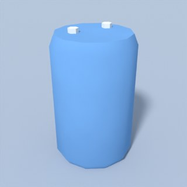 | **Bombona plástica**<br>`tambor_plastico` | plástico | 12 kg | não | sim | 144 | corrida, parque de apoio |
| 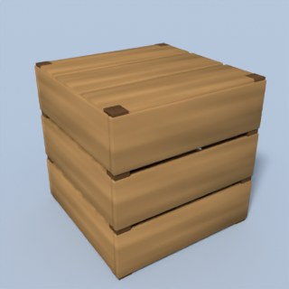 | **Caixa de madeira**<br>`caixa_madeira` | madeira | 14 kg | sim, 6 pedaços (42 N·s) | sim | 720 | corrida, parque de apoio, cidade |
| 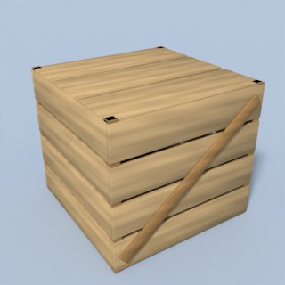 | **Caixote grande de madeira**<br>`caixa_madeira_grande` | madeira | 40 kg | sim, 6 pedaços (120 N·s) | sim | 940 | corrida, parque de apoio |
| 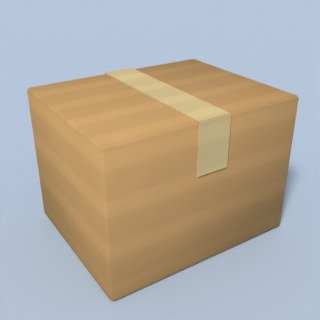 | **Caixa de papelão**<br>`caixa_papelao` | papelão | 2,0 kg | sim, 4 pedaços (5 N·s) | sim | 68 | corrida, parque de apoio, cidade |
| 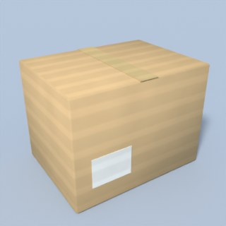 | **Caixa de papelão grande**<br>`caixa_papelao_grande` | papelão | 4,0 kg | sim, 4 pedaços (10 N·s) | sim | 68 | corrida, parque de apoio, cidade |
| 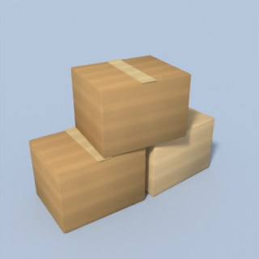 | **Pilha de caixas de papelão**<br>`caixas_papelao_pilha` | papelão | 7,0 kg | sim, 3 pedaços (11 N·s) | sim | 168 | corrida, parque de apoio, cidade |
| 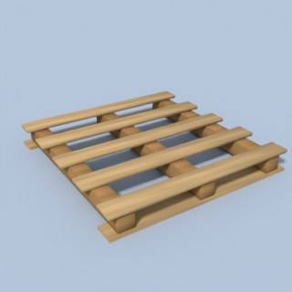 | **Palete de madeira**<br>`palete` | madeira | 22 kg | sim, 6 pedaços (77 N·s) | sim | 376 | corrida, parque de apoio, cidade |
| 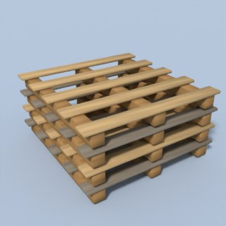 | **Pilha de paletes**<br>`paletes_pilha` | madeira | 88 kg | sim, 4 pedaços (176 N·s) | não | 1.408 | corrida, parque de apoio |
| 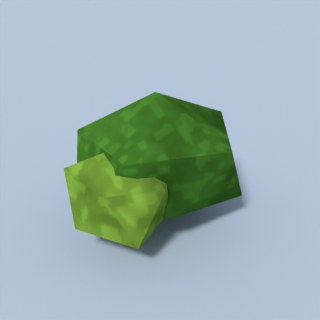 | **Arbusto**<br>`arbusto` | vegetal | 6,0 kg | sim, 4 pedaços (18 N·s) | sim | 60 | corrida, cidade, concessionária |
| 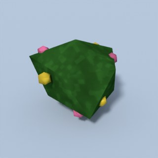 | **Arbusto florido**<br>`arbusto_florido` | vegetal | 6,0 kg | sim, 4 pedaços (18 N·s) | sim | 200 | corrida, cidade, concessionária |
| 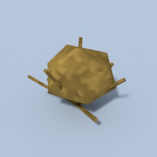 | **Arbusto seco**<br>`arbusto_seco` | vegetal | 3,0 kg | sim, 4 pedaços (9 N·s) | sim | 132 | corrida |
| 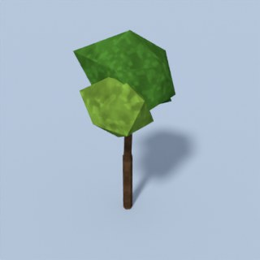 | **Arvoreta folhosa**<br>`arvoreta_folhosa` | vegetal | 35 kg | sim, 4 pedaços (77 N·s) | sim | 108 | corrida, cidade, concessionária |
| 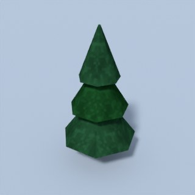 | **Arvoreta pinheiro**<br>`arvoreta_pinheiro` | vegetal | 40 kg | sim, 4 pedaços (88 N·s) | sim | 132 | corrida |
| 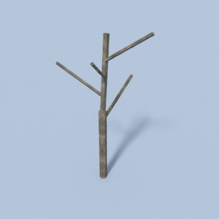 | **Arvoreta seca**<br>`arvoreta_seca` | vegetal | 18 kg | sim, 4 pedaços (36 N·s) | sim | 108 | corrida |
| 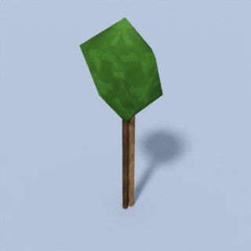 | **Muda com estaca**<br>`muda_estacada` | vegetal | 5,0 kg | sim, 2 pedaços (10 N·s) | sim | 68 | corrida, cidade, concessionária |
| 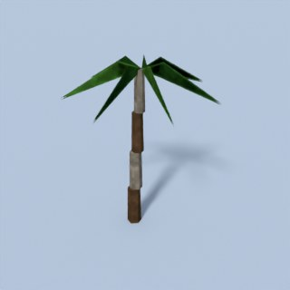 | **Palmeira pequena**<br>`palmeira_pequena` | vegetal | 30 kg | sim, 5 pedaços (66 N·s) | sim | 124 | corrida, cidade, concessionária |
| 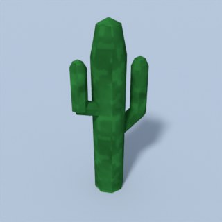 | **Cacto**<br>`cacto` | vegetal | 40 kg | sim, 3 pedaços (100 N·s) | sim | 188 | corrida |
| 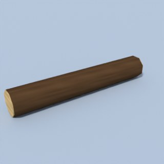 | **Tora pequena**<br>`tora_pequena` | madeira | 110 kg | não | não | 80 | corrida |
|  | **Tora grande**<br>`tora_grande` | madeira | 600 kg | não | não | 100 | corrida |
|  | **Pilha de toras**<br>`toras_pilha` | madeira | 1.200 kg | sim, 6 pedaços (4.800 N·s) | não | 528 | corrida |
|  | **Toco de árvore**<br>`toco` | madeira | 220 kg | não | não | 160 | corrida |
|  | **Pedra pequena**<br>`pedra_pequena` | pedra | 45 kg | não | não | 20 | corrida, cidade |
|  | **Pedra média**<br>`pedra_media` | pedra | 320 kg | não | não | 40 | corrida |
|  | **Laje de pedra**<br>`pedra_achatada` | pedra | 500 kg | não | não | 20 | corrida, concessionária |
|  | **Monte de pedras**<br>`pedras_monte` | pedra | 80 kg | sim, 4 pedaços (160 N·s) | não | 80 | corrida |
|  | **Latão de leite**<br>`latao_leite` | metal | 9,0 kg | não | sim | 164 | corrida, parque de apoio |
|  | **Bandeira de marcação**<br>`bandeira_marcacao` | plástico | 1,2 kg | sim, 2 pedaços (4 N·s) | sim | 28 | corrida |
|  | **Bandeira quadriculada**<br>`bandeira_xadrez` | tecido | 1,5 kg | sim, 2 pedaços (5 N·s) | sim | 164 | corrida, parque de apoio |
|  | **Fileira de bandeirolas**<br>`bandeirolas` | tecido | 3,0 kg | sim, 5 pedaços (8 N·s) | sim | 116 | corrida, parque de apoio, cidade |
|  | **Placa de contagem (3 faixas)**<br>`placa_contagem_3` | madeira | 9,0 kg | sim, 2 pedaços (27 N·s) | sim | 124 | corrida |
|  | **Placa de contagem (2 faixas)**<br>`placa_contagem_2` | madeira | 9,0 kg | sim, 2 pedaços (27 N·s) | sim | 112 | corrida |
|  | **Placa de contagem (1 faixa)**<br>`placa_contagem_1` | madeira | 9,0 kg | sim, 2 pedaços (27 N·s) | sim | 100 | corrida |
|  | **Espantalho**<br>`espantalho` | tecido | 12 kg | sim, 3 pedaços (30 N·s) | sim | 204 | corrida |
|  | **Carrinho de mão**<br>`carrinho_de_mao` | metal | 18 kg | não | sim | 256 | corrida, parque de apoio, cidade |
|  | **Cavalete listrado**<br>`cavalete_listrado` | madeira | 10 kg | sim, 3 pedaços (30 N·s) | sim | 172 | corrida, cidade, parque de apoio |
|  | **Cavalete de obra**<br>`cavalete_obra` | plástico | 7,0 kg | sim, 4 pedaços (21 N·s) | sim | 192 | corrida, cidade |
|  | **Saco de areia**<br>`saco_areia` | tecido | 25 kg | não | sim | 88 | corrida, parque de apoio |
|  | **Muro de sacos de areia**<br>`sacos_areia_pilha` | tecido | 150 kg | sim, 6 pedaços (300 N·s) | não | 264 | corrida, parque de apoio |
|  | **Torre de iluminação**<br>`torre_iluminacao` | metal | 450 kg | não | não | 728 | corrida, parque de apoio |
|  | **Totem de cronometragem**<br>`totem_cronometro` | metal | 18 kg | sim, 2 pedaços (108 N·s) | sim | 160 | corrida, parque de apoio |
|  | **Placa de posto de controle**<br>`placa_ponto_controle` | madeira | 14 kg | sim, 3 pedaços (42 N·s) | sim | 140 | corrida, parque de apoio |

## Parque de apoio

Ferramentas, macacos, compressor, gerador, cadeiras, mesas dobráveis, garrafões, caixas térmicas, rodas, peças de carroceria, tendas e estantes do parque de serviço da equipe. 26 props.

| Prévia | Prop | Material | Massa | Quebra | Voa | Triângulos | Onde serve |
|---|---|---|---|---|---|---|---|
|  | **Caixa de ferramentas**<br>`caixa_ferramentas` | metal | 12 kg | não | sim | 136 | parque de apoio, corrida |
|  | **Carrinho de ferramentas**<br>`carrinho_ferramentas` | metal | 70 kg | não | não | 372 | parque de apoio |
|  | **Macaco hidráulico**<br>`macaco_hidraulico` | metal | 32 kg | não | sim | 256 | parque de apoio |
|  | **Cavalete de mecânico**<br>`cavalete_mecanico` | metal | 6,0 kg | não | sim | 84 | parque de apoio |
|  | **Compressor de ar**<br>`compressor` | metal | 45 kg | não | não | 376 | parque de apoio, cidade |
|  | **Gerador portátil**<br>`gerador` | metal | 85 kg | não | não | 252 | parque de apoio, corrida |
|  | **Cadeira dobrável**<br>`cadeira_dobravel` | metal | 4,0 kg | não | sim | 88 | parque de apoio, corrida, cidade |
|  | **Cadeira de plástico**<br>`cadeira_plastico` | plástico | 3,0 kg | não | sim | 204 | parque de apoio, cidade, corrida |
|  | **Mesa dobrável**<br>`mesa_dobravel` | plástico | 14 kg | não | sim | 156 | parque de apoio, corrida, cidade |
|  | **Garrafão de água**<br>`garrafao_agua` | plástico | 20 kg | não | sim | 204 | parque de apoio, cidade, concessionária |
|  | **Galão de combustível**<br>`galao_combustivel` | metal | 5,0 kg | não | sim | 100 | parque de apoio, corrida |
|  | **Caixa térmica**<br>`caixa_termica` | plástico | 7,0 kg | não | sim | 112 | parque de apoio, cidade, corrida |
|  | **Roda de rali**<br>`roda_rali` | borracha | 18 kg | não | sim | 192 | parque de apoio, concessionária, corrida |
|  | **Pilha de rodas**<br>`rodas_pilha` | borracha | 72 kg | sim, 4 pedaços (216 N·s) | não | 768 | parque de apoio, corrida |
|  | **Para-choque reserva**<br>`para_choque` | plástico | 6,0 kg | não | sim | 392 | parque de apoio |
|  | **Capô reserva**<br>`capo_reserva` | metal | 12 kg | não | sim | 112 | parque de apoio |
|  | **Tenda dobrável**<br>`tenda_dobravel` | tecido | 30 kg | sim, 5 pedaços (180 N·s) | sim | 72 | parque de apoio, corrida, cidade |
|  | **Extintor**<br>`extintor` | metal | 9,0 kg | não | sim | 108 | parque de apoio, concessionária, cidade |
|  | **Balde**<br>`balde` | plástico | 1,0 kg | não | sim | 112 | parque de apoio, cidade, corrida |
|  | **Bancada de trabalho**<br>`bancada_trabalho` | madeira | 45 kg | não | não | 192 | parque de apoio |
|  | **Estante de peças**<br>`estante_pecas` | metal | 40 kg | não | sim | 316 | parque de apoio |
|  | **Caixa plástica de peças**<br>`caixa_pecas` | plástico | 3,0 kg | não | sim | 92 | parque de apoio, cidade |
|  | **Mangueira enrolada**<br>`mangueira_enrolada` | plástico | 8,0 kg | não | sim | 184 | parque de apoio, cidade |
|  | **Bandeira vela**<br>`bandeira_vela` | tecido | 3,0 kg | não | sim | 120 | parque de apoio, concessionária, corrida |
|  | **Painel do parque de apoio**<br>`placa_parque` | madeira | 16 kg | sim, 4 pedaços (48 N·s) | sim | 116 | parque de apoio, corrida |
|  | **Rack de pneus**<br>`rack_pneus` | metal | 60 kg | não | não | 624 | parque de apoio, concessionária |

## Concessionária

Vasos, sofás, poltronas, balcões, totens, expositores de rodas e pneus, plataforma giratória e móveis de escritório para a loja de carros. 17 props.

| Prévia | Prop | Material | Massa | Quebra | Voa | Triângulos | Onde serve |
|---|---|---|---|---|---|---|---|
|  | **Vaso com planta**<br>`vaso_planta` | concreto | 25 kg | não | sim | 100 | concessionária, cidade |
|  | **Vaso alto com capim**<br>`vaso_alto` | concreto | 40 kg | não | sim | 120 | concessionária, cidade |
|  | **Palmeira em vaso**<br>`palmeira_vaso` | vegetal | 30 kg | não | sim | 80 | concessionária |
|  | **Sofá de dois lugares**<br>`sofa` | tecido | 45 kg | não | não | 344 | concessionária |
|  | **Poltrona**<br>`poltrona` | tecido | 25 kg | não | sim | 220 | concessionária |
|  | **Mesa de centro de vidro**<br>`mesa_centro_vidro` | vidro | 25 kg | sim, 4 pedaços (50 N·s) | sim | 72 | concessionária |
|  | **Balcão de recepção**<br>`balcao_recepcao` | madeira | 140 kg | não | não | 136 | concessionária |
|  | **Totem informativo**<br>`totem_informativo` | metal | 40 kg | não | sim | 124 | concessionária, cidade |
|  | **Expositor de rodas**<br>`expositor_rodas` | metal | 35 kg | não | sim | 664 | concessionária, parque de apoio |
|  | **Torre de pneus**<br>`expositor_pneus` | borracha | 60 kg | não | não | 672 | concessionária, parque de apoio |
|  | **Cadeira de escritório**<br>`cadeira_escritorio` | plástico | 12 kg | não | sim | 292 | concessionária |
|  | **Mesa de vendedor**<br>`mesa_vendedor` | madeira | 50 kg | não | não | 116 | concessionária |
|  | **Banqueta alta**<br>`banqueta` | metal | 5,0 kg | não | sim | 124 | concessionária, cidade |
|  | **Luminária de chão**<br>`luminaria_chao` | metal | 6,0 kg | não | sim | 140 | concessionária |
|  | **Divisória de vidro**<br>`divisoria_vidro` | vidro | 30 kg | sim, 6 pedaços (60 N·s) | sim | 60 | concessionária, cidade |
|  | **Plataforma giratória**<br>`plataforma_giratoria` | metal | 400 kg | não | não | 336 | concessionária |
|  | **Pedestal com cordão**<br>`pedestal_corda` | metal | 9,0 kg | sim, 3 pedaços (36 N·s) | sim | 328 | concessionária |

## Cidade

Bancos, postes, lixeiras, hidrantes, bancas, placas de trânsito sem texto, ponto de ônibus, semáforo e o que mais enfeita a rua de uma vila. 24 props.

| Prévia | Prop | Material | Massa | Quebra | Voa | Triângulos | Onde serve |
|---|---|---|---|---|---|---|---|
|  | **Banco de praça**<br>`banco_praca` | madeira | 40 kg | sim, 6 pedaços (160 N·s) | sim | 328 | cidade, concessionária, parque de apoio |
|  | **Poste de luz**<br>`poste_luz` | metal | 220 kg | não | não | 144 | cidade, concessionária |
|  | **Lixeira de rua**<br>`lixeira` | metal | 15 kg | não | sim | 222 | cidade, concessionária, parque de apoio |
|  | **Contêiner de lixo com rodas**<br>`lixeira_container` | plástico | 14 kg | não | sim | 136 | cidade, parque de apoio |
|  | **Hidrante**<br>`hidrante` | metal | 90 kg | não | não | 268 | cidade |
|  | **Banca de revistas**<br>`banca_jornal` | metal | 380 kg | não | não | 400 | cidade |
|  | **Placa octogonal de parada**<br>`placa_pare` | metal | 10 kg | sim, 2 pedaços (100 N·s) | sim | 92 | cidade, corrida |
|  | **Placa de direção**<br>`placa_seta` | metal | 10 kg | sim, 2 pedaços (100 N·s) | sim | 60 | cidade, corrida |
|  | **Placa circular de proibição**<br>`placa_proibido` | metal | 10 kg | sim, 2 pedaços (100 N·s) | sim | 148 | cidade |
|  | **Semáforo**<br>`semaforo` | metal | 130 kg | não | não | 256 | cidade |
|  | **Pilarete**<br>`pilarete` | concreto | 60 kg | não | não | 80 | cidade, concessionária |
|  | **Floreira de concreto**<br>`floreira_concreto` | concreto | 420 kg | não | não | 116 | cidade, concessionária |
|  | **Caixa de correio**<br>`caixa_correio` | metal | 15 kg | sim, 2 pedaços (120 N·s) | sim | 120 | cidade |
|  | **Abrigo de ponto**<br>`ponto_onibus` | metal | 320 kg | não | não | 152 | cidade |
|  | **Bicicletário**<br>`bicicletario` | metal | 30 kg | não | sim | 252 | cidade, concessionária |
|  | **Grade de obra**<br>`grade_obra` | metal | 18 kg | não | sim | 316 | cidade, parque de apoio, corrida |
|  | **Cabine de telefone**<br>`orelhao` | plástico | 50 kg | não | não | 224 | cidade |
|  | **Carrinho de compras**<br>`carrinho_compras` | metal | 14 kg | não | sim | 324 | cidade |
|  | **Parquímetro**<br>`parquimetro` | metal | 25 kg | não | sim | 92 | cidade |
|  | **Caixote de feira com frutas**<br>`caixote_feira` | madeira | 9,0 kg | sim, 5 pedaços (27 N·s) | sim | 652 | cidade, corrida |
|  | **Barril de madeira**<br>`barril_madeira` | madeira | 50 kg | sim, 4 pedaços (250 N·s) | não | 216 | cidade, corrida, parque de apoio |
|  | **Engradado de garrafas**<br>`engradado_garrafas` | vidro | 14 kg | sim, 4 pedaços (42 N·s) | sim | 620 | cidade, parque de apoio |
|  | **Painel de vidro no cavalete**<br>`painel_vidro` | vidro | 22 kg | sim, 4 pedaços (44 N·s) | sim | 88 | cidade, parque de apoio |
|  | **Vaso de cerâmica**<br>`vaso_ceramica` | concreto | 18 kg | sim, 4 pedaços (54 N·s) | sim | 120 | cidade, concessionária |

## Pastas

- `modelos/<id>.glb`: o prop pronto para uso em tempo real, com o objeto `Inteiro` e, nos quebráveis, os pedaços `Peca_NN`.
- `texturas/prop_<material>.png`: as texturas de 64×64 px de cada material (as mesmas que vão dentro dos `.glb`).
- `previas/<id>.jpg`: uma vista três-quartos de cada prop.
- `catalogo.json`: todos os props com categoria, material, massa, resistência, pedaços, colisor, dimensões, triângulos e os caminhos dos arquivos.
- `docs/`: imagem de capa.

## Como usar os modelos

- Metros, eixo Y para cima. A frente do prop aponta para +Z. A origem fica no chão, no centro da base.
- O objeto `Inteiro` é o prop montado. Nos quebráveis, os pedaços `Peca_00`, `Peca_01`... vêm no mesmo arquivo, cada um com a origem no próprio centro e posicionado onde fica no prop montado: esconda os pedaços enquanto o prop está inteiro.
- A cor está na cor por vértice (`COLOR_0`) e a textura de cada material é cinza: o material multiplica as duas. Materiais sem brilho combinam com o visual: difuso simples, filtro bilinear e neblina por distância.
- Muitos props iguais numa cena: desenhe por instâncias (uma chamada de desenho por tipo de prop).

Exemplo em JavaScript, com o carregador de glTF da sua biblioteca web 3D:

```js
const catalogo = await (await fetch("catalogo.json")).json();
const def = catalogo.props.find((p) => p.id === "caixa_madeira");
const glb = await carregadorGltf.loadAsync(def.arquivo);
const inteiro = glb.scene.getObjectByName("Inteiro");
const pecas = glb.scene.children.filter((o) => o.name.startsWith("Peca_"));
for (const p of pecas) p.visible = false; // só aparecem quando o prop quebra
cena.add(glb.scene);
```

## Física: derrubar, arremessar e quebrar

O catálogo traz o que a física precisa de cada prop:

- `massa` (kg) e `voa` (leve o bastante para sair voando quando um carro bate);
- `colisor`: uma forma simples no espaço do prop, `caixa` (`centro`, `meia` = meias medidas), `cilindro` (`centro`, `raio`, `meiaAltura`) ou `esfera` (`centro`, `raio`);
- `quebra` e `resistencia`: o impulso, em N·s (kg·m/s), que quebra o prop. Uma regra simples que funciona bem: a cada passo da física, se `massa × variação de velocidade do prop no passo` passar da `resistencia`, o prop quebra;
- `pedacos`: para cada pedaço, o `centro` no espaço do prop, as meias medidas da caixa (`meia`) e a `massa`. Ao quebrar, remova o corpo do prop inteiro e crie um corpo por pedaço na posição do prop girada (posição do prop + rotação × `centro`), com a velocidade do prop (somada à rotação dele) e um pequeno empurrão para fora do centro. Pedaços leves podem sumir depois de alguns segundos.

Dicas do jogo onde os props nasceram:

- Crie os props dormindo e sem gravidade, poucos centímetros acima do chão, e ligue a gravidade só quando algo encostar neles: assim centenas de props na beira da estrada não custam nada até serem atingidos, e os finos (estacas, placas, arvoretas) não tombam sozinhos na encosta.
- Pedaços não precisam colidir entre si nem com os props inteiros: só com o chão e com os carros.
- Os raios da suspensão do carro devem ignorar os props, para o carro não "subir" num cone.
- Pesados (toras, rolos de feno, barreiras de concreto, pedras) seguram o carro; leves (cones, caixas de papelão, estacas) quase não tiram velocidade dele.

## Perguntas frequentes

**Em que formato estão os props?**
Em glTF 2.0 binário (`.glb`), um arquivo por prop, com malhas, material e textura embutidos. As texturas também estão soltas em PNG na pasta `texturas/`.

**Posso importar em qualquer motor de jogo ou programa 3D?**
Sim, em qualquer motor, biblioteca web ou editor 3D que leia glTF 2.0. Não há extensões proprietárias: só malhas, cor por vértice, um material simples e uma textura PNG.

**Posso usar num jogo comercial?**
Sim. Os props estão em domínio público (CC0 1.0): use, modifique e redistribua sem pedir licença nem dar crédito. O crédito é bem-vindo (veja [`CITATION.cff`](CITATION.cff)).

**Os props trazem marcas ou textos de empresas?**
Não. Placas, totens, bancas e embalagens são genéricos, sem logotipo, marca ou texto de empresa real.

**Como sei quais quebram e em quantos pedaços?**
No [`catalogo.json`](catalogo.json): `quebra`, `resistencia`, `pecas` e a lista `pedacos` de cada prop. Nas tabelas acima, a coluna Quebra mostra o número de pedaços e a resistência.

**Como foram feitos?**
Por script, um prop por receita, com formas chanfradas, cor por vértice e texturas pequenas pintadas por material; os pedaços saem dos grupos do modelo (tábuas, caixas de uma pilha) ou de fatias do objeto inteiro.

## Licença

[CC0 1.0 Universal](LICENSE): domínio público.

## Como citar

Os metadados de citação estão em [`CITATION.cff`](CITATION.cff).
